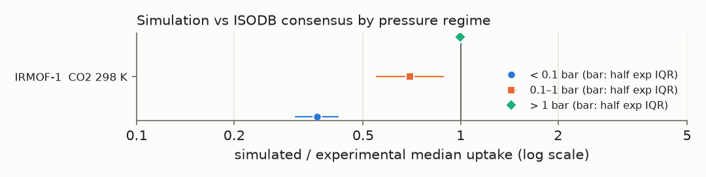

# gcmc-tools

Two tools that work as one pipeline. Tool 1 runs RASPA3 GCMC isotherms. Tool 2 cleans
experimental isotherms from NIST ISODB. Together they are used to study how and why simulated
isotherms of common MOFs and zeolites differ from experiment. `docs/MISSION.md` is the plan.
`docs/RECON.md`, `docs/FORCEFIELD.md`, `docs/LOG.md` and `docs/FINDINGS.md` record what was
checked and found.

Status: all phases done. Full matrix (6 materials × CO2/CH4/N2 at 298 K + CO2 at 273 K) simulated and
compared with NIST ISODB; the report is [`reports/REPORT.md`](reports/REPORT.md).

## Report summary


Full report: [`reports/REPORT.md`](reports/REPORT.md) (per-material figures, the cause-by-cause tests and
limitations). Findings with their evidence are in [`docs/FINDINGS.md`](docs/FINDINGS.md).

- **Bad experimental metadata was the largest single source of disagreement.** 11 of 188 ISODB isotherms are
  physically implausible at their stated temperature (e.g. 77 K-shaped N2 labelled 298 K). They produced every
  extreme sim/exp ratio (0.00–0.19 and 10.7–12.1). A physics-only screen removes them; the screen was written after
  inspecting the data, so the unscreened numbers are reported alongside.
- **Mg-MOF-74 CO2 is the one clear model failure.** Henry coefficient 0.17× experiment, low-pressure uptake 0.09×,
  wrong isotherm shape. The model already puts CO2 at the Mg sites (46 % within 3 Å), so the missing piece is
  binding strength, which LJ plus point charges cannot supply.
- **HKUST-1, IRMOF-1 and ZIF-8 agree within lab-to-lab spread above 0.1 bar.** Labs disagree with each other by
  1.1–1.8×, mostly by a constant factor, the signature of variable sample quality.
- **UiO-66 is overpredicted 1.6–2× at every pressure.** Charges off or all-UFF LJ do not close the gap, so lost
  pore volume in real samples is the more likely cause (not directly testable from ISODB).
- **The simulation is converged and the thermodynamic corrections are small.** 4× cycles and a larger box change
  loadings by ≤ 2.4 %; non-ideality ≤ 9 % at 10 bar; excess vs absolute ≤ 7 % for CO2 (but 11–43 % for N2, and only
  7 of 207 records state their basis). The largest model sensitivity is the LJ set: UFF instead of DREIDING raises
  ZIF-8 CO2 2.2×.
- **Below 0.1 bar the data can't test the model:** 14 of 17 comparisons there rest on a single paper.


## Requirements
- Conda env `ads` with `raspa3` 3.0.29 (conda-forge), pandas, scipy, matplotlib, pyyaml, pytest, pygaps.
- `~/projects/raspa3-src` checked out at tag `v3.0.29`. Read only; it is used for force-field
  provenance and the example-11 regression inputs.
- tmux, for long runs.

## Tool 1: `gcmc isotherm`

```bash
# A case from cases/cases.yaml (structure, recipe and provenance are in data/structures/<id>/)
bin/gcmc isotherm --case IRMOF-1 --gas CO2 --T 298 --jobs 8

# The same, detached in tmux (log: runs/<case>/<gas>_<T>K/<label>/driver.log)
bin/gcmc isotherm --case IRMOF-1 --gas CO2 --T 298 --detach

# An explicit charged P1 CIF (MOF recipe; charges must be in the CIF)
bin/gcmc isotherm --cif my.cif --gas CH4 --T 298 --pressures 0.1 1 10 --cycles 20000 --init-cycles 5000

# Re-collect results and the plot for a finished run folder
bin/gcmc collect runs/IRMOF-1/CO2_298K/real_vf-auto
```

Defaults:
- Peng–Robinson fugacity (`--ideal-gas` for φ = 1).
- Helium void fraction computed with `raspa3-cli` (`--void-fraction default` omits it, which means
  1.0; or pass a number).
- Unit cells chosen so every perpendicular width is ≥ 2 × 12 Å.
- Ewald real-space cutoff 12 Å.
- Points that end above 5% relative error, or show drift, are re-run once with more cycles
  (`--no-extend` turns this off).
- Each isotherm also gets a Widom-only run (Henry coefficient) and a one-molecule NVT run
  (zero-loading enthalpy).

What it does:
1. Every point is a folder `runs/<case>/<gas>_<T>K/<label>/gcmc/gcmc_<P>Pa_<hash>/` whose name
   carries a hash of all inputs. `run.json` lists the settings and the sha256 of every file.
2. Re-running the same command skips complete points and re-runs crashed or truncated ones. The old
   output is kept as `output.failed-N`. A point is complete only if the output finished, the framework
   atom count matches the CIF and the net charge is zero. This catches RASPA3 silently reading 0
   atoms from a CIF that has no `_atom_site_type_symbol`.
3. It writes `results/<case>/<gas>_<T>K_<label>.csv`, a tidy table with one row per point and basis
   (`material_id, adsorbate, T_K, P_bar, loading_mmol_g, loading_err_mmol_g, basis, source, source_id,
   doi, notes`). Also `..._points.csv` (fugacity coefficient, void fraction, drift, enthalpy, cycles,
   wall time), `....json` (settings, Henry coefficient, ΔH₀, Henry/Langmuir/DSL fits with
   uncertainties) and `....png`.

## Tool 2: `gcmc isodb` and `gcmc compare`

```bash
# Fetch (sparse checkout of the NIST-ISODB/isodb-library mirror) and clean, for the case's temperatures
bin/gcmc isodb --case HKUST-1 --gas CO2                 # 298 and 273 K from cases.yaml, +/- 2 K
bin/gcmc isodb --case HKUST-1 --gas CO2 --T 298 --T-window 1

# Compare a simulated isotherm with the cleaned data (second temperature for Clausius-Clapeyron)
bin/gcmc compare --case HKUST-1 --gas CO2 --T 298 --T-second 273 \
    --sim results/HKUST-1/CO2_298K_regression_corrected.csv
```

- Raw records: every candidate is copied unchanged to `data/isodb_raw/records/`. The mirror clone is
  gitignored and its commit is recorded in `data/isodb_clean/*_meta.json`.
- Material matching: exact hashkeys from `cases/cases.yaml`. Registry name and synonym matches are
  logged in `data/isodb_clean/isodb.log`.
- Cleaning rules (in order; the first failure is the reason):
  1. case adsorbent;
  2. single component;
  3. T within window;
  4. experimental (isotherm category `exp`, or empty with paper categories exactly `exp`);
  5. units on the allowlist (`units.py`; wt%, kg/mol, per-volume and per-unit-cell units are rejected);
  6. at least 3 usable points after dropping null values, P ≤ 0, adsorption == pressure artifacts
     and desorption points;
  7. not a duplicate of an accepted record.
- Outputs:
  - `data/isodb_clean/<case>_<gas>_<T>K.csv`: the tidy table.
  - `..._ledger.csv` and the combined `ledger.csv`: one row per candidate, with reason, original
    units, DOI, sample flags, title mentions and outlier score.
- Consensus: median and IQR across papers (one vote per paper: within-paper median first) on a
  log-P grid, interpolating only inside each isotherm's measured range. Outliers (Tukey fences on
  each isotherm's median log10 ratio to the consensus) are flagged, kept, and shown dashed.
- Comparison outputs, in `results/<case>/compare/`:
  - log10(sim/exp median) by regime (< 0.1, 0.1–1, > 1 bar), with and without outliers;
  - whether the simulation is inside the experimental IQR;
  - experimental spread (IQR ratio);
  - Henry coefficients (Widom vs per-isotherm low-P slopes);
  - per-paper Clausius–Clapeyron heats (only when a paper has exactly one isotherm at each temperature);
  - plot.

## Full matrix and analysis

```bash
# All cases x gases x temperatures from cases/cases.yaml in one shared longest-first pool (resumable)
bin/gcmc matrix --label main --jobs 8 --detach          # log: runs/matrix_main.log
bin/gcmc matrix --cases HKUST-1 IRMOF-1 --gases CO2 --cycles 10000 --label quick

# Experimental data for every case/gas (both CO2 temperatures)
for c in MFI IRMOF-1 HKUST-1 Mg-MOF-74 UiO-66 ZIF-8; do
  for g in CO2 CH4 N2; do bin/gcmc isodb --case $c --gas $g; done
done

# Phase 5: sensitivity runs (4x cycles, bigger cell, charges off, all-UFF LJ, snapshots) and all tests
conda run -n ads python scripts/phase5_runs.py --jobs 8
conda run -n ads python scripts/phase5_analysis.py --label main   # results/phase5/*.csv, compare plots
conda run -n ads python scripts/oms_snapshots.py                  # nearest-metal distances (cause 6)
conda run -n ads python scripts/report_assets.py                  # reports/tables.md, reports/fig_*.png
```

- `results/phase5/comparisons.csv`: sim/exp ratio by regime under the Gate-2 rules (`head_*`), without outliers
  (`noout_*`), strict filters (`strict_*`) and after the plausibility screen (`scr_*`); basis effect; GCMC vs Widom.
- `results/phase5/plausibility_flags.csv`: records removed by `clean.plausibility_flags` (post-hoc, physics only).
- `results/phase5/{henry,ideal_gas,low_p_slopes,sample_quality,sample_quality_summary,sensitivity,oms_snapshots}.csv`.

## Tests
```bash
conda run -n ads python -m pytest -q
```
