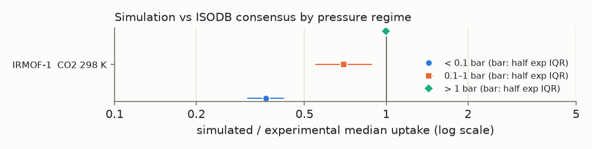
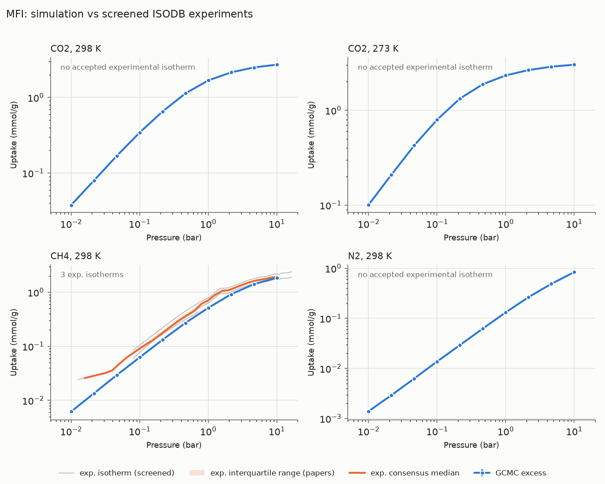
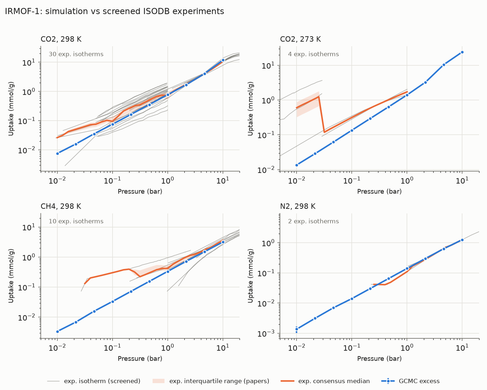
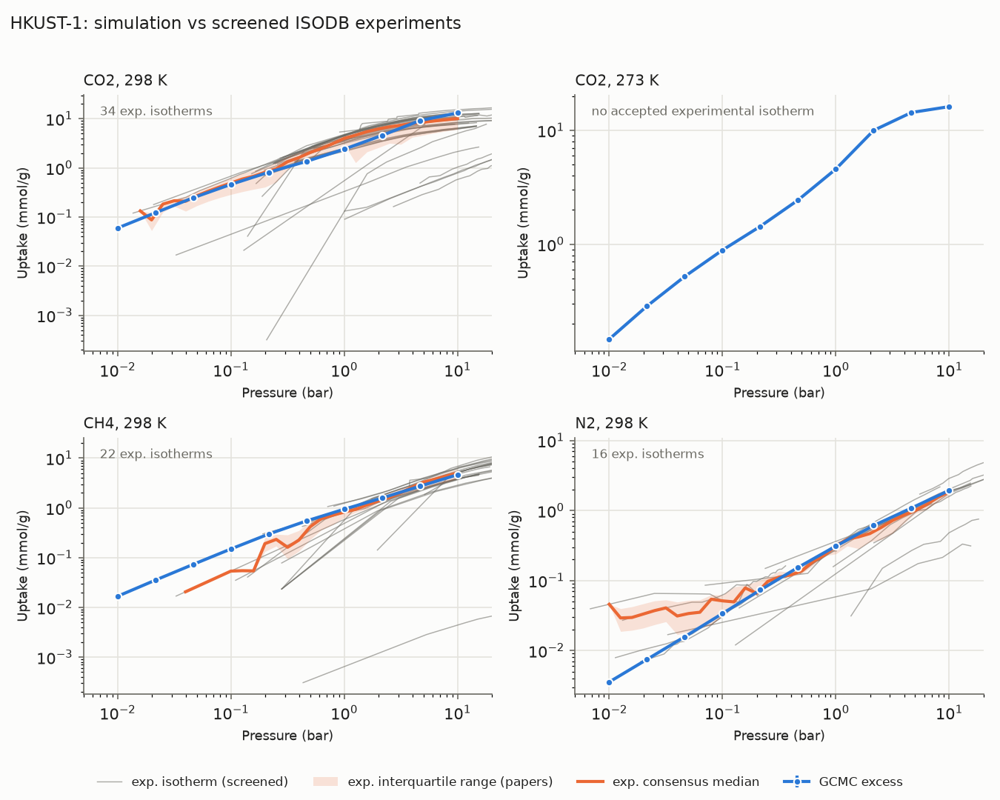
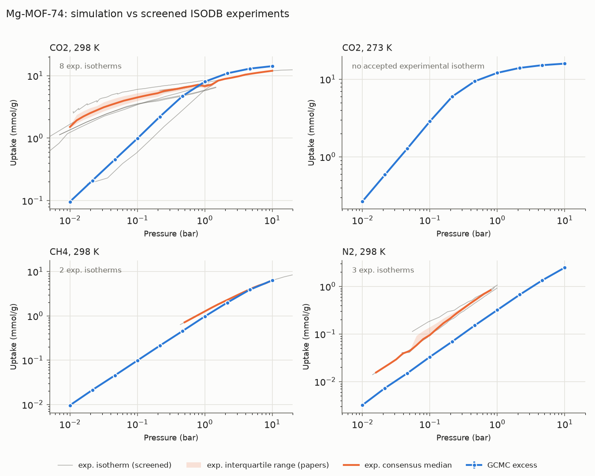
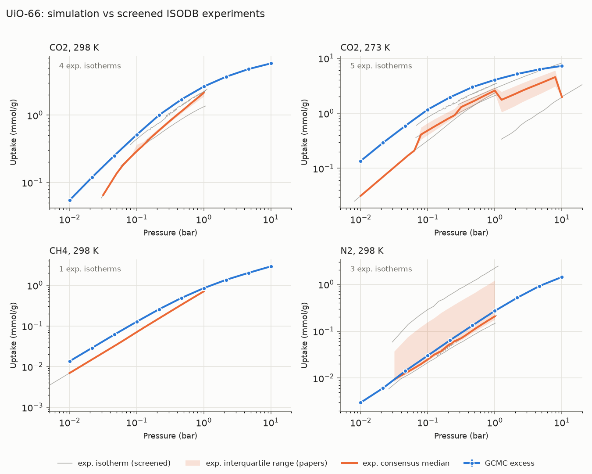
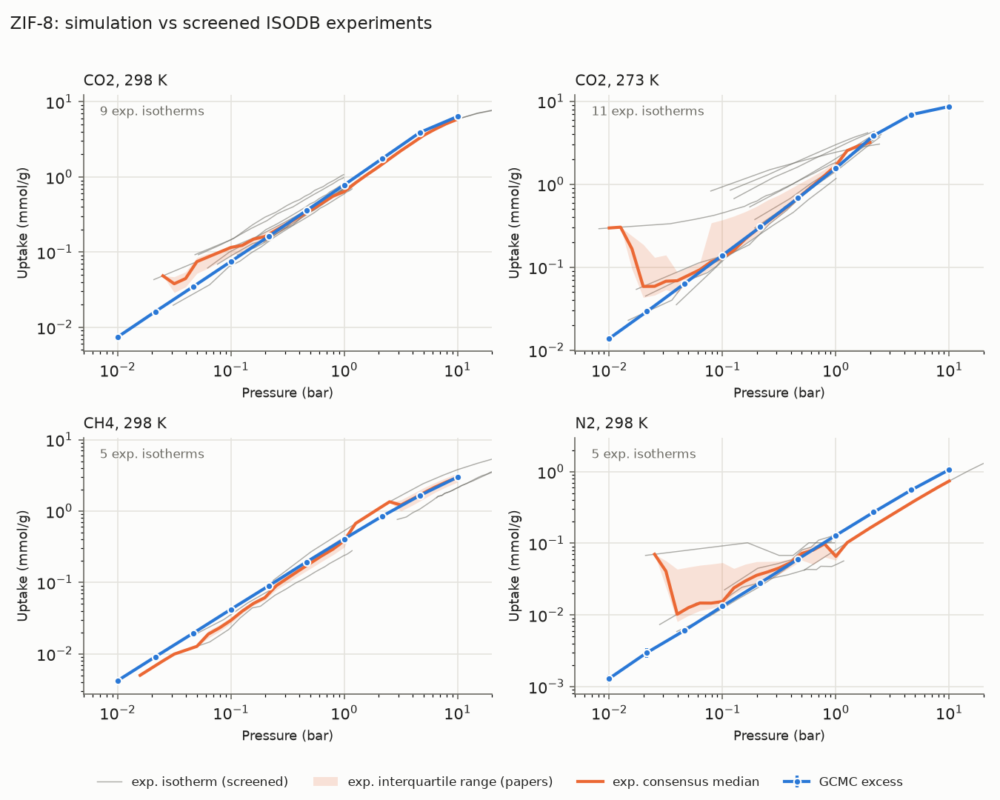

# Why simulated and experimental isotherms differ: six porous materials, CO2 / CH4 / N2

GCMC isotherms from a single generic force-field recipe (RASPA3 3.0.29) are compared with every usable
experimental isotherm in NIST ISODB for MFI, IRMOF-1, HKUST-1, Mg-MOF-74, UiO-66 and ZIF-8. The gases are CO2, CH4
and N2 at 298 K, plus CO2 at 273 K, at 0.01–10 bar. Every number in this report is in `results/` (simulation and
analysis) or in a data-cleaning ledger in `data/isodb_clean/`. Generated tables are in
[`reports/tables.md`](tables.md). The finding IDs (F…) refer to [`docs/FINDINGS.md`](../docs/FINDINGS.md).

## Summary

1. **Bad experimental metadata was the largest source of disagreement, more than any simulation setting.**
   11 of 188 accepted isotherms are physically impossible or inconsistent at their stated temperature, for example
   N2 isotherms labelled 298 K that look like 77 K isotherms. Those few records produced the most extreme headline
   numbers: sim/exp ratios of 0.00–0.19 and 10.7–12.1, and experimental Henry coefficients of 95–876 mmol/g/bar.
   Below 0.1 bar, 14 of 17 comparisons rest on a single paper (F5.1–F5.3).
2. **Mg-MOF-74 is the only clear case of missing open-metal-site physics.** Simulated CO2 uptake is 0.09× experiment
   below 0.1 bar, and the Henry coefficient is 0.17× (3 papers). The mismatch is in shape, not scale: the experiments
   bend over below 0.1 bar, while the simulation is nearly linear up to about 0.2 bar. HKUST-1, which also has open
   copper sites, agrees with experiment for CO2 (ratios 0.79–0.94; F5.10, F5.11). Snapshots show the model already
   puts 46 % of CO2 molecules within 3 Å of Mg, so what is missing is binding strength, not site geometry (F5.18).
3. **Where data are adequate, the simulation lies within lab-to-lab spread.** That covers HKUST-1, IRMOF-1 and ZIF-8
   above 0.1 bar. Experiments for the same material disagree with each other by 1.1–1.8× at 0.1–1 bar (6.8× for
   UiO-66 N2). Labs differ mainly by a constant scale factor, which is the signature of variable sample quality
   (F5.8, F5.12).
4. **UiO-66 is overpredicted by 1.6–2× for CO2 and CH4 at every pressure, by a nearly constant factor.** This fits
   lost or inaccessible pore volume in real samples, but also fits model overbinding (F5.9). Neither switching
   charges off (→ about 1.1–1.3×) nor all-UFF LJ (→ about 2×) brings it to agreement (F5.16, F5.17).
5. **Gas non-ideality, the excess/absolute basis, the temperature window and simulation precision cannot explain any
   gap above about 10 % for CO2** (F5.5–F5.7, F5.14, F5.15). 4× cycles and a larger box change loadings by ≤ 2.4 %. The basis does matter for N2: absolute and excess differ by
   11–43 % in IRMOF-1, ZIF-8 and HKUST-1, and only 7 of 207 experimental records state their basis.
6. **The method control is weak.** MFI has no usable experimental CO2 or N2 isotherm in ISODB. For CH4, the only gas with data, the
   simulation is 16–36 % below its 3 isotherms.

## 1. Method

**Simulation (Tool 1, `gcmc isotherm` / `gcmc matrix`).**
- **Software:** RASPA3 3.0.29, conda-forge.
- **Structures:**
  - MOFs: CoRE MOF 2014-DDEC (IRMOF-1, HKUST-1, Mg-MOF-74, ZIF-8) and CoRE MOF 2019 with PACMAN charges (UiO-66).
  - MFI: the pure-silica structure from RASPA3 example 10.
  - Provenance and checksums are in `data/structures/<id>/PROVENANCE.md`.
- **Force field:** rigid framework. Lennard-Jones parameters are DREIDING for H/C/N/O and UFF for metals, with
  Lorentz–Berthelot mixing, a 12 Å cutoff, no tail corrections and Ewald electrostatics. MFI uses the TraPPE-zeo model
  from example 10.
- **Adsorbates:** TraPPE CO2, N2 and CH4 (`docs/FORCEFIELD.md`).
- **Thermodynamics:** Peng–Robinson fugacity. Helium void fraction from `raspa3-cli`, one framework-only value per
  structure (MFI 0.294, IRMOF-1 0.804, HKUST-1 0.746, Mg-MOF-74 0.726, UiO-66 0.515, ZIF-8 0.484).
- **Box size:** enough unit cells that every perpendicular width is at least 24 Å.
- **Cycles and pressures:** 20,000 production + 5,000 initialization cycles at 10 log-spaced pressures. A point is
  re-run with 2–4× more cycles if its relative error is above 5 % or it drifts. Points with under one molecule in the
  box are flagged instead of extended.
- **Extra runs per isotherm:** a Widom run for the Henry coefficient and a one-molecule NVT run for ΔH₀.
- **Regression:** Phase 1 reproduced the earlier HKUST-1 CO2 isotherm at all 8 points (F1.1).
- **Cost:** the full matrix (24 isotherms, 288 runs) took 9.4 h wall at 8 jobs and 60.7 CPU h for the GCMC points.

**Experiment (Tool 2, `gcmc isodb` / `gcmc compare`).**
- **Source:** ISODB records from the NIST-ISODB/isodb-library mirror (commit `9e1ee47`). Records are matched by
  adsorbent hashkey and cleaned by fixed rules:
  1. single component;
  2. T within ±2 K;
  3. experimental (paper-level labels used when the isotherm label is empty; mixed exp/sim papers rejected as
     ambiguous);
  4. allowlisted units;
  5. at least 3 adsorption points;
  6. not a duplicate.
- **Sample flags:** titles that indicate shaped or humid/aged samples flag the record, which is shown but not used.
- **Consensus:** the median across papers (one vote per paper) on a log-pressure grid, interpolated only inside each
  isotherm's range.
- **Ratio:** simulated excess divided by the consensus median, taken as the median over grid points in three regimes
  (< 0.1, 0.1–1, > 1 bar). The 'unknown' basis is treated as excess.
- **Post-hoc screen (Phase 5):** after inspecting the data, records failing a physics-only plausibility screen were
  removed (§2). The screen never uses a simulated value. Headline numbers under the Gate-2 rules are reported next to
  the screened ones.

## 2. Data cleaning

| | isotherms |
|---|---:|
| ISODB candidates (summed over the 24 case/gas/T targets) | 2845 |
| rejected: temperature outside ±2 K | 2010 |
| rejected: not experimental (304) or ambiguous exp/sim labels (131) | 435 |
| rejected: mixture or different adsorbate | 154 |
| rejected: units (wt%, cm³(STP)/cm³, mol/mol, kg/mol, …) | 33 |
| rejected: duplicate (4), < 3 points (2) | 6 |
| accepted | 207 |
| accepted but sample-flagged (shaped, humid/aged) | 19 |
| pristine | 188 |
| removed by the plausibility screen | 11 |
| **used in the comparison** | **177** |

The full per-target table is in [`tables.md`](tables.md). The plausibility screen (`clean.plausibility_flags`) has two
rules:
- **R1:** a supercritical gas (N2, CH4 at about 298 K) with an apparent q/P above 20 mmol/g/bar below 0.1 bar. Henry
  constants for these gases in porous solids are about 0.1–3 mmol/g/bar.
- **R2:** an isotherm at one temperature that sits on the wrong side of the better-sampled other temperature's
  experimental consensus. Adsorption is exothermic, so loading must fall as T rises.

| rule | removed | what they look like |
|---|---|---|
| R1 | HKUST-1 CH4 and N2 (10.1021/la800803w); IRMOF-1 N2 (10.1016/j.micromeso.2008.04.033); ZIF-8 N2 (10.1021/am5028346) | 5–37 mmol/g reached below 0.05 bar; apparent q/P 394–2162 mmol/g/bar. These look like 77 K isotherms labelled 298 K |
| R2 | HKUST-1 CO2 273 K (all 3 records, 2 papers); Mg-MOF-74 CO2 273 K (the only record); ZIF-8 CO2 298 K (3 records of 10.1039/C4ee01009d) | HKUST-1 273 K records reach 0.39 mmol/g at 1 bar, far below the 298 K data; the ZIF-8 records may be genuine sample variants |

Two coverage gaps limit the study. MFI has no accepted CO2 or N2 isotherm at either temperature: its candidates are
other temperatures, simulated records or mixtures. And only 7 of 207 accepted records state an adsorption basis.

## 3. Results overview



*Markers: screened sim/exp ratio per regime. Bars: half the experimental interquartile range across papers (none
where only one paper contributes).*

Summary table. Each cell gives the screened ratio, the fewest papers behind any grid point in that regime in
parentheses, and whether the simulation lies inside the experimental IQR on at least half the grid points
(✓ = yes, ✗ = no, n/a = only one paper, so the IQR is undefined). Causes are numbered as in MISSION §7. Status
codes: **S** tested-supported, **R** tested-rejected, **U** untested.

| Case | Gas | T (K) | < 0.1 bar | 0.1–1 bar | > 1 bar | causes |
|---|---|---:|---|---|---|---|
| MFI | CH4 | 298 | 0.64 (1) n/a | 0.74 (2) ✗ | 0.84 (2) ✗ | 1 R, 2 R, 3 R, 4 R (CO2 test), 5 R, 7 U (CO2 only), 8 U |
| MFI | CO2, N2 | both | no exp. data | | | – |
| IRMOF-1 | CO2 | 298 | 0.35 (1) n/a | 0.70 (3) ✗ | 1.00 (3) ✓ | 1 S (low P: one paper), 2 R, 3 R, 4 R, 5 S, 6 n/a (control), 7 R (0.81–1.11×) |
| IRMOF-1 | CO2 | 273 | 0.10 (2) ✗ | 0.56 (2) ✗ | – | 1 S (one paper dominates), 5 S |
| IRMOF-1 | CH4 | 298 | 0.08 (1) n/a | 0.48 (1) n/a | 0.85 (6) ✗ | 1 S (one paper dominates low/mid P), 2 S (1.17) |
| IRMOF-1 | N2 | 298 | – | 1.33 (1) n/a | 1.02 (1) n/a | 1 S (Gate-2 ratio 0.00), 2 S (1.39) |
| HKUST-1 | CO2 | 298 | 0.94 (1) ✓ | 0.79 (4) ✓ | 0.93 (14) ✓ | 1 R, 2 R, 3 R, 4 R, 5 S, 6 R, 7 R (charges off 0.77×, UFF 1.04–1.13×) |
| HKUST-1 | CO2 | 273 | no usable exp. data (3/3 fail R2) | | | 1 S |
| HKUST-1 | CH4 | 298 | 2.96 (1) n/a | 1.45 (1) n/a | 0.98 (7) ✓ | 1 S (R1 record), 5 S |
| HKUST-1 | N2 | 298 | 0.25 (1) n/a | 0.99 (5) ✓ | 1.13 (6) ✓ | 1 S (R1 record), 2 S (1.11), 5 S |
| Mg-MOF-74 | CO2 | 298 | 0.09 (2) ✗ | 0.54 (2) ✗ | 1.20 (1) n/a | 6 S, 1 R, 3 R, 4 R, 7 R (both variants move away), 5 U |
| Mg-MOF-74 | CO2 | 273 | no usable exp. data (1/1 fails R2) | | | 1 S |
| Mg-MOF-74 | CH4 | 298 | – | 0.72 (1) n/a | 0.94 (1) n/a | too few data |
| Mg-MOF-74 | N2 | 298 | 0.35 (1) n/a | 0.30 (3) ✗ | – | 6 S (likely), 2 R (1.10) |
| UiO-66 | CO2 | 298 | 1.98 (1) n/a | 1.58 (3) ✗ | – | 5 S (proxy), 4 R, 7 R (no-charge ≈ 1.1–1.3, UFF ≈ 2), 8 U |
| UiO-66 | CO2 | 273 | 4.02 (1) n/a | 1.86 (3) ✗ | 2.05 (1) n/a | 5 S (proxy), 8 U |
| UiO-66 | CH4 | 298 | 1.92 (1) n/a | 1.57 (1) n/a | – | 5 S (proxy), 8 U |
| UiO-66 | N2 | 298 | 1.13 (3) ✓ | 1.28 (3) ✓ | – | labs disagree 6.8× |
| ZIF-8 | CO2 | 298 | 0.57 (1) n/a | 1.00 (2) ✗ | 1.17 (2) ✗ | 1 S (R2), 4 R, 7 S (UFF LJ 2.2×), 8 U |
| ZIF-8 | CO2 | 273 | 0.61 (1) n/a | 1.00 (4) ✓ | 0.93 (1) n/a | 5 S |
| ZIF-8 | CH4 | 298 | 1.37 (1) n/a | 1.14 (2) ✓ | 0.97 (1) n/a | 5 S |
| ZIF-8 | N2 | 298 | 0.52 (1) n/a | 0.90 (2) ✗ | 1.52 (1) n/a | 1 S (Gate-2 ratio 0.01), 2 S (1.16), 8 U |

Causes 4 and 7 were tested on CO2 at 298 K only (0.01–1 bar). For cause 7, **R** means neither variant shifts the
ratio enough, or in the right direction, to explain the gap; **S** marks a set whose agreement depends strongly on
the LJ choice.

## 4. Cases

### MFI (silicalite-1, method control)


MFI was meant as the control: a rigid, defect-poor, all-silica framework with a well-established force field. ISODB
cannot fill that role here. All 24 CO2 candidates fail at 298 K and 273 K (temperature, simulated records, mixtures),
and so do all 28 N2 candidates, so only CH4 can be compared. Its 3 papers agree closely with each other: the spread
between isotherms is 0.05 decades and the shape mismatch within each isotherm is 0.06 decades. The simulation sits
16–36 % below them at every pressure (ratios 0.64 (1), 0.74 (2), 0.84 (2)). The Widom Henry coefficient is 0.645
against 0.976 mmol/g/bar from the one experimental isotherm with enough low-pressure points. Neither non-ideality
(< 1 % at 10 bar) nor the basis (1.01–1.04) explains this. A constant 20–35 % deficit for a non-polar molecule
points to the CH4–framework Lennard-Jones interaction or to the structure model; this was not tested.
The simulation is converged: for CO2, 4× cycles and a larger box change MFI loadings by ≤ 2 % (F5.15). Turning
the TraPPE-zeo charges off cuts MFI CO2 uptake to 0.28–0.46× (F5.16), so the zeolite charge model matters for
CO2. It does not affect CH4.

### IRMOF-1 (MOF-5, no open metal sites)


**CO2 at 298 K.** The 30 isotherms from 8 papers agree with the simulation above 1 bar (1.00 (3)) and at
0.1–1 bar sit within 1.4× of it (0.70 (3)). The experimental spread is 1.6× between papers. The spread is mostly a
constant factor: 0.22 decades between isotherms against 0.04 within, the sample-quality signature.

Below 0.1 bar the simulation is lower (0.35), but that consensus rests on one paper. The single experimental Henry
coefficient (0.61 mmol/g/bar) is *below* the simulated 0.81, the opposite direction. So the low-pressure experiments
disagree with each other, and the low-pressure deficit is not established.

**CO2 at 273 K** has the same problem. Two records from one paper (10.1016/j.ijhydene.2011.11.023) reach
1.5–3.7 mmol/g by 0.03 bar, more than 10× the other two papers at that pressure, and set the low-pressure ratio of 0.10.

**CH4** agrees within 15 % above 1 bar (0.85 (6)). The 0.08 and 0.48 ratios at lower pressure come from a single
isotherm (10.1002/anie.200502553).

**N2:** the Gate-2 ratio of 0.00 came entirely from one 77 K-shaped record. After the screen, N2 agrees (1.33 and
1.02, one paper each).

The simulated CO2 isotherm keeps curving upward to 10 bar, which is where non-ideality matters most: an ideal gas
would raise it by 8.4 % at 10 bar. IRMOF-1 also has the largest absolute/excess difference in the set (CH4 1.17,
N2 1.39 at 1 bar), so the unstated experimental basis matters for these gases. For CO2 the result is robust to
the charge and LJ choice (0.81–1.11×; F5.16).

### HKUST-1 (Cu-BTC, open Cu sites)


**CO2 at 298 K** is the best-sampled set: 34 isotherms from 18 papers. The simulation (DDEC charges, generic LJ) lies
inside the experimental interquartile range on most of the grid in every regime (ratios 0.94 (1), 0.79 (4),
0.93 (14)). The Widom Henry coefficient (6.12) matches the only experimental estimate (6.31 mmol/g/bar).

The spread between labs is large: the IQR is 1.8–2.3× wide, 7 isotherms are low Tukey outliers, and the
between-isotherm spread is 0.50 decades against 0.11 within. Experiments here vary by about a factor 3 in scale while
keeping roughly the simulated shape. That pattern points to differing sample activation or quality rather than to the
model. With this spread, a 20 % model error could not be detected.

**CO2 at 273 K:** the Gate-2 ratio of 11–12 came from 3 records that sit *below* the 298 K experiments (0.39 mmol/g
at 1 bar). After the screen no usable data remain.

**CH4 and N2** agree above 0.1 bar (0.98 (7) and 0.99 (5)/1.13 (6)). The Gate-2 low-pressure ratios of 0.01 and
0.19 came from two 77 K-shaped records from one paper.

The open Cu sites leave no measurable low-pressure CO2 deficit in this model. The earlier example-11 model with
different charges gave 1.07/1.05/1.03 against the same data (F2.4). At 0.1 bar only 2 % of simulated CO2
molecules have an O within 3 Å of Cu (median O–Cu 4.88 Å), so in this model the Cu sites are barely occupied
(F5.18). Removing the framework charges lowers loading to 0.96× at 0.1 bar and 0.77× at 1 bar, and all-UFF LJ
raises it by 4–13 % (F5.16). The agreement therefore does not hinge on the details of the model.

### Mg-MOF-74 (Mg-DOBDC, open Mg sites)


This is the clearest model failure in the study.

**CO2 at 298 K:** experiments from 5 papers rise steeply and bend over below 0.1 bar, reaching about 3.5–6 mmol/g by
0.1 bar. The simulation is nearly linear up to 0.2 bar and reaches only 1 mmol/g at 0.1 bar. The ratios are 0.09 (2)
below 0.1 bar, 0.54 (2) at 0.1–1 bar, and 1.20 (1) above 1 bar, where the simulation overtakes experiment. The
experimental Henry coefficient is 5.8× the simulated one (55.6 vs 9.53 mmol/g/bar; 6 isotherms, 3 papers).

Unlike every other material, the mismatch within each experimental isotherm (0.35 decades) exceeds the spread between
isotherms (0.16), with a log-ratio slope of −0.66. The model has the wrong *shape*, not the wrong scale. That is the
signature of missing open-metal-site chemistry: strong, specific CO2–Mg²⁺ binding, which Lennard-Jones plus point
charges on a generic UFF Mg cannot reproduce. Cause 6 is supported for CO2.

**N2** shows the same direction at all pressures (0.35 (1), 0.30 (3)). **CH4** (0.72, 0.94; one paper) shows little
effect. **CO2 at 273 K:** the single record is inconsistent with the 298 K data (R2) and was removed.

The simulation's higher uptake above 1 bar suggests the real samples also have less accessible pore volume than the
ideal crystal, but with one paper above 1 bar this is not established.

The snapshots show that the model does put CO2 at the metal: 46 % of molecules have an O within 3.0 Å of Mg and
74 % within 3.5 Å (median 3.04 Å; F5.18). So the deficit is in the *strength* of the CO2–Mg interaction, not in
where CO2 sits. Electrostatics already carry most of the simulated binding: with charges off, loading drops to
0.24–0.33× (F5.16). All-UFF LJ lowers it by a further 5–10 %. Neither variant moves toward experiment, as
expected if the missing term is polarisation or partial chemical bonding that fixed point charges cannot represent.

### UiO-66 (Zr6, defect-prone)


UiO-66 is the only material that the simulation overpredicts at every pressure:
- CO2 at 298 K: 1.98 (1), 1.58 (3);
- CO2 at 273 K: 4.02 (1), 1.86 (3), 2.05 (1);
- CH4: 1.92, 1.57 (one paper).

The factor barely changes with pressure (log-ratio slope 0.07–0.17), and the curves keep the simulated shape (spread
within each isotherm 0.03–0.09 decades). A constant factor fits real samples having less accessible pore volume than
the defect-free crystal, through residual modulator or solvent, incomplete activation or partial collapse (cause 5,
proxy). Missing-linker defects, the best-known UiO-66 imperfection, would normally *raise* uptake. They are not
modelled (cause 8, untested) and would not explain this direction.

Model overbinding would also give a ratio above 1. The UiO-66 charges come from the PACMAN machine-learning model, not
DDEC. With framework charges off, CO2 loading falls to 0.71–0.80×, which would bring the 0.1–1 bar ratio from 1.58
to about 1.1–1.3. All-UFF LJ raises it by 24–34 %, to about 2 (F5.16, F5.17). The charges explain part of the gap
at most, and only if they were far too large, which is not established. The constant factor is still best explained
by sample pore volume, but this remains a proxy result.

**N2** looks like agreement (1.13 (3), 1.28 (3)), but the three papers differ by 6.8× at 0.1–1 bar, so it cannot be
interpreted.

### ZIF-8 (Zn(mIm)2, flexible)


ZIF-8 agrees well where several papers overlap. CO2 is 1.00 (2) at 298 K and 1.00 (4) at 273 K at 0.1–1 bar, and CH4
is 1.14 (2). The deviations below 0.1 bar (0.52–0.61) and above 1 bar (1.17–1.52) each rest on one paper.

**CO2 at 298 K:** 3 isotherms from one paper (10.1039/C4ee01009d) sit above that paper's own 273 K isotherms (R2) and
were removed. The paper reports a series of samples, so this may be real sample variation rather than an error.

**N2:** the Gate-2 low-pressure ratio of 0.01 came from one 77 K-shaped record. After screening the ratio is 0.52 (1).

The rigid model cannot represent linker swing (cause 8, untested). The swing is best known for N2 at 77 K and at high
loading, and the 1.52 ratio for N2 above 1 bar (one paper) is too thin to attribute to it.

The ZIF-8 agreement depends on the LJ set. All-UFF parameters for the imidazolate linker raise CO2 loading 2.2× at
every pressure (F5.16), which would turn the 1.00 ratio into about 2.2. Framework charges barely matter (0.96–0.99×).
The DREIDING result agrees with experiment and the UFF result does not; this is an observation, not a reason to
prefer DREIDING in general.

## 5. Causes tested

| # | cause | test | result |
|---|---|---|---|
| 1 | data artifacts | ledger review, strict filters, post-hoc plausibility screen | **Supported** in 10 sets: the screen removed 11 records from 7 sets, and they produced every extreme headline ratio; in 3 more (IRMOF-1 CO2 298/273 K, CH4) one paper sets the low-pressure ratio. The strict filter (±0.5 K, ≥ 5 points, no outliers) changes mid-P ratios by ≤ 0.12 and misses the R1 records (F5.1–F5.5) |
| 2 | excess vs absolute, void fraction | both bases from the simulation | absolute/excess ≤ 1.07 for CO2 at 1 bar (≤ 1.05 at 10 bar), so **rejected** for CO2. 1.11–1.43 for N2 in HKUST-1/ZIF-8/IRMOF-1 and 1.17 for IRMOF-1 CH4, so it **matters**; 7 of 207 records state a basis (F5.6) |
| 3 | gas non-ideality | ideal-gas loading from the real-gas isotherm at f = P | ≤ 0.9 % at 1 bar; 0.3–8.7 % at 10 bar. **Rejected** above 10 % (F5.7) |
| 4 | convergence, system size | 4× cycles and +1 unit cell at 0.1 and 1 bar; GCMC vs Widom | GCMC/Widom at 0.01 bar is 0.69–1.01, which follows the excess correction, so the simulated side is precise to about 5 % (F5.14). 4× cycles change loadings by 0.992–1.020 and +1 cell by 0.976–1.011 (|z| ≤ 0.46). **Rejected** (F5.15) |
| 5 | sample quality | between- vs within-isotherm spread of log(exp/sim) (proxy; no record carries a pore volume or BET area) | Between > within in 14 of 16 sets. Strongest in HKUST-1 CO2 (3× scale spread) and UiO-66 (constant 1.6–2× overprediction) (F5.8, F5.9) |
| 6 | open metal sites | Henry and low-P ratios across cases; nearest-metal distances | **Supported** for Mg-MOF-74 (Henry 0.17×, shape mismatch). **Rejected** as a large effect for HKUST-1 CO2 (F5.10, F5.11). Snapshots: 46 % of CO2 within 3 Å of Mg, 2 % of Cu, so the Mg-MOF-74 deficit is binding strength, not site placement (F5.18) |
| 7 | charges / LJ set | framework charges off; all-UFF LJ (CO2, 298 K, 0.01–1 bar) | Charges off: 0.24–0.33× (Mg-MOF-74), 0.28–0.46× (MFI), 0.71–0.99× elsewhere. UFF: 0.90–1.34×, except ZIF-8 2.2×. **No variant reconciles a disagreeing set**; ZIF-8 agreement depends on the LJ set (F5.16, F5.17) |
| 8 | framework effects (defects, flexibility) | not testable with a rigid, defect-free model | **Untested.** Needs defective UiO-66 models (missing-linker cells) and flexible-ZIF-8 MD/GCMC, or experiments with characterised defect density |

## 6. Ranked findings

1. **Metadata errors dominate the extreme disagreements.** Five cryogenic-shaped isotherms labelled 298 K, and 273 K
   records that sit below the 298 K data, produced every sim/exp ratio below 0.2 or above 10 under the Gate-2 rules.
   A physics-only screen removes them (F5.1, F5.2). Evidence: `results/phase5/plausibility_flags.csv`, Gate-2 vs
   screened columns in `results/phase5/comparisons.csv`.
2. **Open-metal-site binding is missing for Mg-MOF-74 CO2.** The Henry ratio is 0.17 (3 papers), the low-pressure
   ratio 0.09, and the shape mismatch is larger than the lab-to-lab spread (F5.10). HKUST-1 does not show it with
   this model (F5.11).
3. **Lab-to-lab variation is often as large as the model error.** The IQR is 1.1–1.8× at 0.1–1 bar and 6.8× for
   UiO-66 N2. The variation is mostly constant-factor, which points to sample quality. Simulations within 0.7–1.4× are
   indistinguishable from experiment for HKUST-1, IRMOF-1 and ZIF-8 (F5.8, F5.12).
4. **UiO-66 is overpredicted by a constant 1.6–2×** for CO2 and CH4 (F5.9). Turning charges off closes only part of
   the gap (to about 1.1–1.3×) and UFF widens it (F5.17), so the sample pore-volume explanation remains the more likely
   one, though untested directly.
5. **The low-pressure regime cannot test the models with ISODB data.** 14 of 17 sets rest on one paper there, and
   experimental low-pressure slopes are flatter than Henry's law (median 0.77 against 1.0 simulated, F5.3, F5.4).
   Meanwhile the simulated low-pressure values agree with the Widom route to about 5 % (F5.14).
6. **Thermodynamic corrections are small.** Non-ideality is ≤ 9 % at 10 bar and the CO2 basis effect ≤ 7 %. They
   cannot explain the gaps that matter, except that the unstated basis is an 11–43 % ambiguity for N2 (F5.6, F5.7).
7. **The simulation is converged; the LJ set is the largest model sensitivity.** 4× cycles and a larger box change
   loadings by ≤ 2.4 % (F5.15). Switching linker LJ from DREIDING to UFF changes ZIF-8 CO2 by 2.2× (F5.16).
8. **MFI cannot serve as a control from ISODB alone.** It has no CO2 or N2 data, and the 3 CH4 papers sit 16–36 %
   above the TraPPE-zeo simulation.

## 7. Limitations

- **Post-hoc screen.** The plausibility screen was written after inspecting the accepted records. It is uniform and
  physics-only, but its threshold (20 mmol/g/bar) and the R2 "better-sampled temperature" rule are judgement calls.
  Gate-2 numbers are reported beside every screened one.
- **Data the ISODB metadata cannot verify.** The basis is unknown for 200 of 207 records and treated as excess. Sample
  activation, pore volume and BET area are not available, so the cause-5 test is a proxy, and it cannot separate
  sample quality from a constant model error.
- **The rigid model.** Frameworks are rigid and defect-free, with one charge set per structure and generic UFF
  metals. No polarisation, no DFT-derived open-metal-site potentials, no flexibility.
- **Imprecise low-pressure points.** Points with under one molecule in the box were not extended. Their error bars are
  conservative; the Widom route checks them (F5.14).
- **Limits of the consensus.** The median is interpolated on a log grid inside each isotherm's range; where papers
  enter or leave the grid, the median jumps (visible in several figures). "Inside IQR" is undefined with one paper.
- **Thin experimental heats.** Per-paper Clausius–Clapeyron heats exist for only 3 sets (F5.13), so heats were not
  used to test the force field.

## 8. Next steps

1. **Fix or annotate the flagged ISODB records upstream.** NIST accepts corrections; the 5 R1 records are clear
   candidates.
2. **Mg-MOF-74:** rerun CO2 with a DFT-derived Mg–CO2 potential, or with polarisable or ab initio-fitted parameters
   from the literature, to test whether the shape mismatch closes. Do this without tuning to the ISODB consensus.
3. **UiO-66:** simulate missing-linker models and partially blocked pores (e.g. residual modulator) to bracket the
   constant-factor gap, and use experiments that report N2 77 K pore volume, so cause 5 can be tested by rescaling.
4. **MFI control:** add non-ISODB experimental CO2/N2 isotherms with documented provenance, or treat a well-validated
   published simulation as a secondary reference.
5. **Basis for N2:** convert experiments to absolute loading only where the paper states its helium void volume.
   Otherwise report N2 comparisons as a range (excess to absolute).

## Reproduce

```bash
conda run -n ads python -m pytest -q                                  # 90 tests
bin/gcmc matrix --label main --jobs 8 --detach                        # ~9 h at 8 jobs (resumable)
for c in MFI IRMOF-1 HKUST-1 Mg-MOF-74 UiO-66 ZIF-8; do for g in CO2 CH4 N2; do bin/gcmc isodb --case $c --gas $g; done; done
conda run -n ads python scripts/phase5_runs.py --jobs 8               # sensitivity runs (~22 CPU h)
conda run -n ads python scripts/phase5_analysis.py --label main       # all comparisons and tests
conda run -n ads python scripts/oms_snapshots.py                      # nearest-metal distances
conda run -n ads python scripts/report_assets.py                      # tables.md and figures
```
